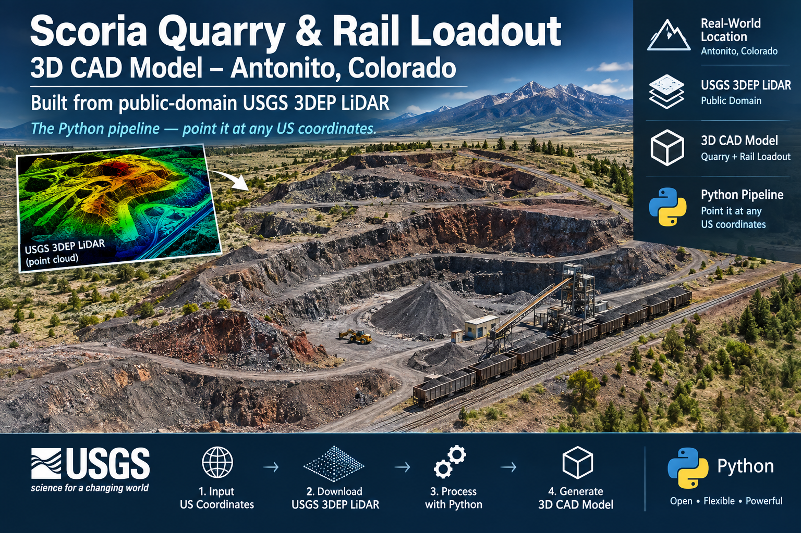

# Red Hill Lava Products — 3D site model

**4000 US Highway 285, Antonito, Colorado 81120**
Scoria quarry, bagging plant and rail loadout, Conejos County.

**Live viewer:** https://jkh2.github.io/red-hill-lava-model/

Built from public-domain airborne LiDAR. No Google Maps geometry was used —
Google's imagery and 3D tiles are licensed and their terms forbid deriving
models from them. Google Places was used only to confirm the business name,
street address and gate coordinate.

---

## Files

| File | What it is |
|---|---|
| `red_hill_site.obj` + `.mtl` | The main CAD model. Terrain, structures, roads, rail and drainage as five named groups. 226,874 vertices / 449,512 triangles. |
| `red_hill_terrain_solid.stl` | Watertight terrain solid, 572,504 triangles, 2.5 m sampling. Booleans cleanly; prints without repair. |
| `red_hill_site_viewer.html` | Self-contained WebGL viewer. Drop it on GitHub Pages as-is. |
| `stockpiles.csv` | 30 piles with volume, footprint, crest height and UTM position. |
| `structures.csv` | 29 structures with footprint, height and top elevation. |
| `build_red_hill_model.py` | The generator. Change the coordinates and it runs anywhere in the country. |
| `stage1_grids.py` | Reads the raw `.laz` tiles and builds the 1 m grids the generator consumes. Run this first. |
| `index.html` | Identical to the viewer, named so GitHub Pages serves it at the repo root. |

The LiDAR tiles themselves (`.laz`, ~108 MB) are deliberately **not** in the
repo — they are re-downloadable from USGS and `stage1_grids.py` will fetch
them. See `.gitignore`.

---

## Coordinate system

```
X = UTM 13N easting  − 411048.0
Y = UTM 13N northing − 4101191.0
Z = NAVD88 elevation − 2390.0
```

Units metres, Z up. Horizontal datum NAD83(2011) / UTM zone 13N, **EPSG:26913**.
Vertical datum NAVD88, Geoid18.

To georeference in QGIS, Civil3D, Rhino or Blender, translate by
`(+411048.0, +4101191.0, +2390.0)` and assign EPSG:26913.

Model extent: 1,280 m east–west × 695 m north–south.
Ground elevations 2394.7 – 2413.8 m NAVD88 (7,857 – 7,919 ft).

---

## Sources

**Terrain, structures, stockpiles** — USGS 3DEP LiDAR, project
`CO_SanLuisJuanMiguel_2020_D20`, flown 2020, 1 m nominal. Raw `.laz` point
cloud tiles `13S_DB_1101` and `13S_DB_1001`, 3.68 M ground returns and
265,804 above-ground returns inside the model box. Public domain.

**Roads, rail, drainage** — OpenStreetMap, © OpenStreetMap contributors,
ODbL. Attribution required if you publish the viewer.

**Site identification** — Google Places (name, address, gate coordinate only).

---

## How it was built

**Ground surface.** Class-2 (bare earth) returns averaged into a 1 m grid,
voids filled by nearest neighbour and lightly smoothed. Stockpiles are part
of the ground surface, so they appear in the terrain mesh directly.

**Structures.** The 1 m bare-earth DEM products USGS distributes have
buildings stripped out, so those are useless here. Structures come from
class-1 (unclassified) returns instead: max height per cell above the ground
surface, blobs under 12 m² discarded, then **stepped extrusion** through
height tiers at 2/4/6/9/12/16/20/25/31 m. Flat prisms would have averaged the
22 m screen tower down to about 6 m — the tiers keep it.

**Stockpiles.** Base pad surface estimated by grey opening with a 60 m disc,
then smoothed. Anything standing 1 m or more above that base, covering at
least 60 m² and holding at least 150 m³, is called a pile.

**Linework.** OSM ways reprojected to UTM, clipped to the model box,
resampled at 6 m and draped on the terrain as ribbons.

---

## What the LiDAR found that the address didn't

The Google pin sits on the truck loading yard. The operation actually runs
about 700 m west of it: a processing and bagging plant on the SLRG
Alamosa–Antonito rail spur, with a 22 m screen tower and its own yard tracks.

Red Hill's business listing gives `coloradolava.com` as its website, and OSM
has the access road tagged "Colorado Lava Road" (BLM 5032), which ties the two
complexes together. Red Hill states it bags and ships by rail from Antonito
using its own rail cars — which is exactly what the loadout geometry shows.

The model covers both complexes.

---

## Inventory as flown

| | |
|---|---|
| Stockpiles | 30 |
| Total volume above pad | **54,208 yd³** (41,445 m³) |
| Largest single pile | 14,404 yd³ |
| Structures | 29 objects, 11,085 m² footprint |
| Tallest structure | 22.0 m |

---

## Limitations — read these before trusting it

**The flight was 2020.** Stockpile volumes are a snapshot six years old. Piles
move. Treat these as a baseline, not current inventory.

**Parcel boundaries are unknown.** This is a contiguous industrial corridor
that the evidence links to Red Hill / Colorado Lava. If part of the west
complex belongs to a neighbouring operator, the model does not know it. That
takes one drive-by to settle.

**Open frames read thin.** Structures are reconstructed from laser returns.
Conveyor galleries, screen decks and anything with an open steel frame will
appear narrower and lower than the real thing. Solid-walled buildings are
close.

**Stepped extrusion is a simplification.** Structure solids are height tiers,
not surveyed geometry. Good for massing, siting, drainage and visualisation.
Not a substitute for a plan set.

**Pile volumes depend on the assumed pad.** They are volumes above a computed
base surface, not above a surveyed pad elevation. Expect a few percent of
disagreement with a ground survey, more for piles built against a slope.

---

## Running it somewhere else

`build_red_hill_model.py` expects the LiDAR tiles already downloaded. To find
and fetch tiles for any US location:

```python
import requests
r = requests.get('https://tnmaccess.nationalmap.gov/api/v1/products', params={
    'bbox': 'minlon,minlat,maxlon,maxlat',
    'datasets': 'Lidar Point Cloud (LPC)',
    'max': 20}).json()
for item in r['items']:
    print(item['title'], item['downloadURL'])
```

Then set `CX`, `CY`, `HALF` in `stage1_grids.py` and `XMIN/XMAX/YMIN/YMAX`
in the builder to your area.

Coverage is effectively national: at the end of fiscal year 2025, 99% of the
United States had 3DEP baseline data available or in progress. Alaska is
IfSAR rather than LiDAR. Acquisition dates range from roughly 2011 to the
present, so always check the project year before trusting anything that moves.

**Requires:** `laspy[lazrs]`, `numpy`, `scipy`, `scikit-image`, `shapely`,
`pyproj`, `trimesh`, `rasterio` (optional).
